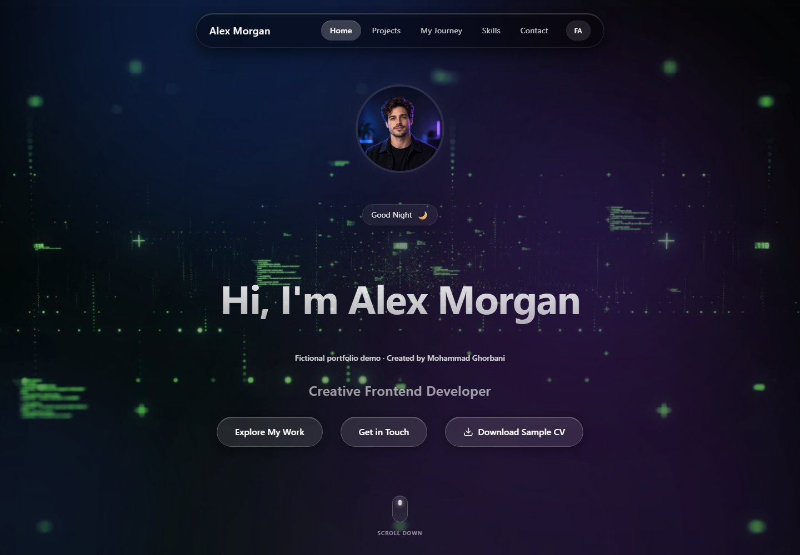
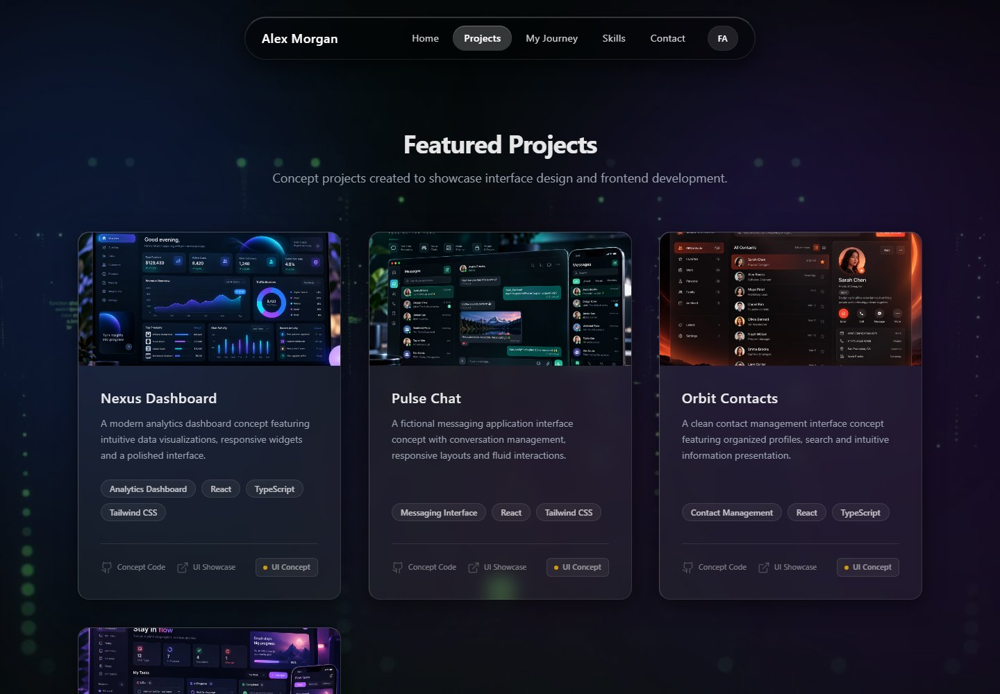
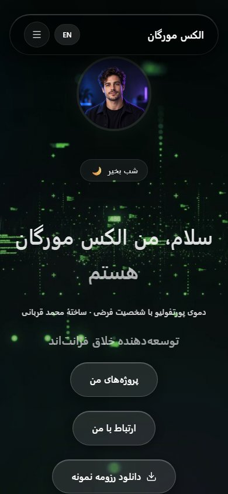

# Interactive Developer Portfolio — Fictional Demo

A bilingual, interactive developer portfolio built with **React 19, TypeScript, Vite, Tailwind CSS v4, and Motion**. The project focuses on polished frontend presentation, responsive layouts, and scroll-driven animation.

**[Live Demo](https://portfolio-demo.mohammadghorbani-dev.ir/)** · **[Source Code](https://github.com/MohammadGhorbani-dev/personal-portfolio)**

> **About this demo:** This website was created by **Mohammad Ghorbani**. **Alex Morgan** is a fictional portfolio persona—not the developer or owner of the project. The biography, career history, project concepts, GitHub-style statistics, social profiles, and downloadable resume are sample content created for demonstration.

## Screenshots

Desktop, English. The creator credit appears alongside the fictional persona.



Desktop project gallery with clearly marked concept cards.



Mobile, Persian. The navigation, introduction, and demo disclosure use right-to-left layout.



These screenshots were captured from the running production build at 1440×1000 and 390×844. They show sample content.

## Engineering case study

I built this demo to show how an expressive portfolio can support both English and Persian while keeping navigation and content usable on smaller screens. My work covers the React components, translations, layout, interaction design, and performance review.

The scroll background originally requested all 150 JPEG frames when the page opened. I changed it to show one static frame first and load the current scroll frame and its neighbor on demand, with at most two image requests in flight and a bounded decoded-image cache. A failed frame keeps the last usable background visible. Project images and social card imagery load as they approach the viewport.

The portrait was resized for its display size, reducing the file from 2,145,807 to 21,119 bytes. In a fresh local Chromium page, the initial frame requests fell from the 150-frame startup loop to a single frame request. These are file-size and request-count observations from the local production build.

The reduced-motion preference uses a static background and suppresses decorative motion. Automated browser checks cover both language directions, the initial media requests, a failed background image, reduced motion, and the contact form's local demo behavior. The project cards illustrate interface concepts, and the form reports its demonstration status directly to the visitor.

## Highlights

- **English and Persian:** Language switching with left-to-right (LTR) and right-to-left (RTL) layouts.
- **Scroll-driven animation:** A 150-frame image sequence rendered on HTML Canvas and linked to scroll progress.
- **Interactive UI:** Glassmorphism panels, animated transitions, magnetic buttons, tilt effects, and a custom desktop cursor.
- **Responsive design:** Layouts adapted for desktop and mobile devices.
- **Fictional project gallery:** Four conceptual UI showcases—Nexus Dashboard, Pulse Chat, Orbit Contacts, and Flow Tasks.
- **Demo-only interactions:** The contact form validates input locally but **does not send or store messages**. Social profile cards and GitHub-style statistics are illustrative rather than connected to real accounts.
- **Sample resume:** A downloadable fictional CV is included to demonstrate the portfolio's download flow.

## Tech Stack

| Area | Technology |
| --- | --- |
| UI | React 19, TypeScript |
| Tooling | Vite |
| Styling | Tailwind CSS v4 |
| Animation | Motion, HTML Canvas |
| Icons | Lucide React, React Icons |
| Hosting | Cloudflare Pages |

## Getting Started

### Requirements

- Node.js 20 or newer is recommended.
- npm

Dependencies are pinned in `package-lock.json`. Use `npm ci` for local and hosted builds.

### Run locally

```bash
git clone https://github.com/MohammadGhorbani-dev/personal-portfolio.git
cd personal-portfolio
npm ci
npm run dev
```

The development server is configured to run at **http://localhost:3000**.

### Available commands

```bash
npm run dev      # Start the development server
npm run lint     # Run TypeScript type checking (tsc --noEmit)
npm run build    # Generate the production build in dist/
npm run preview  # Preview the production build locally
npm run test:e2e # Test the built demo with Chromium
```

For browser checks, run `npm run build`, `npx playwright install chromium`, and `npm run test:e2e`. The test runner starts a local preview server automatically. GitHub Actions runs the locked install, TypeScript check, production build, and desktop/mobile browser checks on pushes and pull requests.

## Project Files

```text
src/
  components/       React UI components and animations
  context/          English/Persian translations and language state
public/
  profile.jpg        Fictional persona portrait
  p1.jpg - p4.jpg   Concept project images
  cv.pdf             Fictional sample resume
  frames/            150 JPEG frames for the scroll animation
  assets/gifs/       Animated imagery for social showcase cards
```

The assets under `public/` are required for the complete visual experience. The mock project images are **concept illustrations**, not proof of separately deployed applications.

## Deployment

The live demo is deployed on **Cloudflare Pages** from the GitHub repository.

| Setting | Value |
| --- | --- |
| Production branch | `main` |
| Build command | `npm run build` |
| Output directory | `dist` |

The current demo does not require backend credentials or environment variables for its contact form and sample statistics.

## Credits and Scope

**Created and maintained by [Mohammad Ghorbani](https://github.com/MohammadGhorbani-dev).**

This repository demonstrates a **portfolio frontend**, not production implementations of the fictional messaging, analytics, contacts, or productivity products featured in its cards. No live social accounts or payment services are connected to the demo showcase.

The source code, configuration, tests, and project documentation are licensed under [Apache-2.0](LICENSE). This permits reuse, including commercial reuse, subject to the license conditions. The demo's images, GIFs, sample CV, and screenshots have separate reuse terms described in [ASSETS.md](ASSETS.md).
